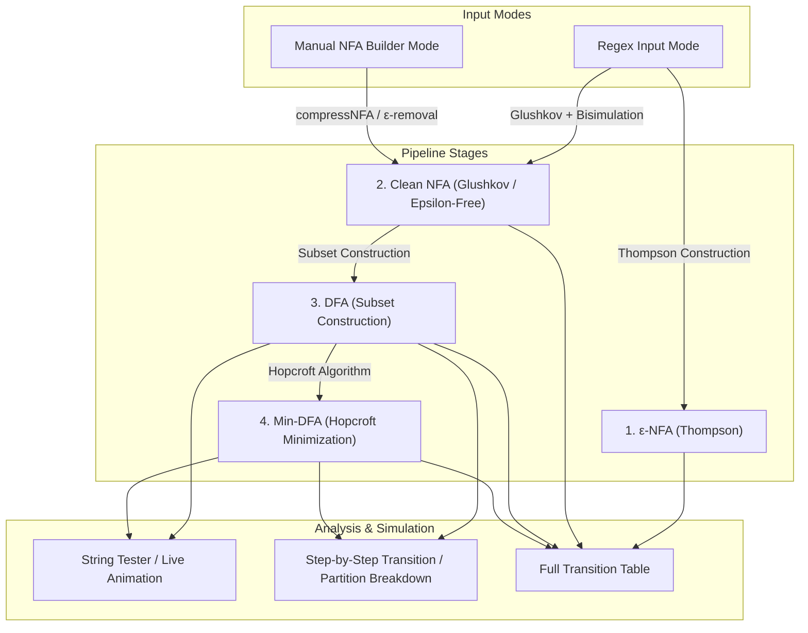

# How Automata Lab Works: Internal Architecture & Algorithm Guide

**Automata Lab** is an interactive Theory of Computation (TOC) simulator built with **React 19**, **Vite**, and **React Flow (@xyflow/react)**. It models, transforms, visualizes, and simulates finite-state automata through formal theoretical pipelines.

---

## 1. High-Level Architecture

The application is structured into two main layers:
1. **Mathematical Algorithm Engine (`src/utils/`)**: Pure JavaScript implementations of formal language and automata theory algorithms (Thompson, Glushkov, Subset Construction, Hopcroft, and BFS Graph Layout).
2. **Interactive UI & Visualization Shell (`src/components/` & `src/App.jsx`)**: React Flow-powered canvas, step navigators, transition matrix tables, string tracer, and state managers.



---

## 2. Pipeline Workflows

The application operates in two distinct operational modes:

### Mode A: Regex Mode
Starts from a regular expression (e.g. `(a|b)*abb`) and generates each stage:
1. **`Regex -> ε-NFA`**: Uses an optimized **Thompson Construction** with state-merging.
2. **`Regex -> NFA`**: Bypasses traditional ε-elimination by directly constructing a canonical minimal ε-free NFA via **Glushkov's Position Automaton** combined with **bisimulation equivalence merging**.
3. **`NFA -> DFA`**: Converts the ε-free NFA to a deterministic automaton using **Subset (Powerset) Construction**.
4. **`DFA -> Min-DFA`**: Reduces the DFA to the unique minimal DFA using **Hopcroft's Partition Refinement**.

### Mode B: Manual NFA Builder Mode
Starts from states and transitions manually specified or randomly generated:
1. **`ε-NFA / NFA -> Clean NFA`**: Eliminates epsilon transitions (`removeEpsilonTransitions`), prunes unreachable states, and applies bisimulation merging (`compressNFA`).
2. **`Clean NFA -> DFA`**: Runs subset construction.
3. **`DFA -> Min-DFA`**: Runs Hopcroft minimization.

---

## 3. Core Algorithms Explained

### 3.1. Optimized Thompson Construction (`src/utils/regexToENFA.js`)
Converts an infix regular expression to an NFA with ε-transitions:
- **Tokenization & Shunting-Yard**:
  - Inserts explicit concatenation operators `·` (e.g. `ab` becomes `a · b`, `a(b|c)` becomes `a · (b|c)`).
  - Converts infix notation to postfix (Reverse Polish Notation) according to operator precedence: `*` / `+` / `?` > `·` > `|`.
- **Concatenation Optimization ("Zero-Bloat")**:
  - Standard Thompson creates an ε-link from `accept(A)` to `start(B)`.
  - Automata Lab **merges `accept(A)` directly with `start(B)`**, absorbing outgoing transitions of `start(B)` into `accept(A)` and deleting `start(B)`. This cuts state count and creates 0 unnecessary ε-links.
- **Peephole Optimization for Simple Unions**:
  - For simple 2-state atoms (like `a|b`), it folds transitions onto the same initial and accept states instead of creating 2 new states and 4 ε-transitions.

### 3.2. Glushkov Position Automaton & Bisimulation (`src/utils/minimalNFA.js`)
Produces a compact ε-free NFA directly from the regex string:
- **Abstract Syntax Tree (AST)**:
  - Recursive-descent parser generates an AST node tree (`union`, `concat`, `star`, `plus`, `optional`, `literal`).
- **Positions & Properties**:
  - Assigns unique sequential integer positions $1 \dots n$ to every literal character in the regex.
  - Computes standard TOC functions bottom-up:
    - $\text{nullable}(node)$: Can the subexpression match the empty string $\varepsilon$?
    - $\text{first}(node)$: Set of positions that can match the first character.
    - $\text{last}(node)$: Set of positions that can match the final character.
    - $\text{follow}(p)$: For position $p$, which positions can immediately follow it.
- **Automaton Synthesis**:
  - States: $\{q_0\} \cup \{q_1 \dots q_n\}$.
  - $\delta(q_0, a) = \{ q_i \mid i \in \text{first}(R) \land \text{sym}(i) = a \}$.
  - $\delta(q_i, a) = \{ q_j \mid j \in \text{follow}(i) \land \text{sym}(j) = a \}$.
  - Accept states: $\{ q_i \mid i \in \text{last}(R) \} \cup (\{q_0\} \text{ if } \text{nullable}(R))$.
- **Bisimulation Merging**:
  - Computes relational equivalence signatures over states: two states that have identical acceptance properties and transition to equivalent target partitions are merged, guaranteeing minimal state counts.

### 3.3. Subset Construction (`src/utils/nfaToDfa.js`)
Converts an NFA $(Q_{NFA}, \Sigma, \delta_{NFA}, q_0, F_{NFA})$ to a DFA $(Q_{DFA}, \Sigma, \delta_{DFA}, S_0, F_{DFA})$:
- **State Representation**:
  - Each DFA state represents a subset of NFA states (e.g. `"{q0, q1}"`).
  - $S_0 = \varepsilon\text{-closure}(\{q_0\})$.
- **BFS Exploration**:
  - A worklist queue processes unseen subsets.
  - For each symbol $a \in \Sigma$:
    $$T = \varepsilon\text{-closure}(\text{move}(S, a))$$
  - If $T \neq \emptyset$, add transition $\delta_{DFA}(S, a) = T$.
  - If $T = \emptyset$, route to an explicit `DEAD` sink state if required to preserve a total transition function.
- **Step Recording**:
  - Every step records `{ from, symbol, to, nfaStates, moveResult, closureResult }` to power the interactive step walkthrough in the UI.

### 3.4. Hopcroft's DFA Minimization (`src/utils/minimizeDFA.js`)
Computes the minimal DFA in $O(|\Sigma| \cdot n \log n)$ time:
1. **Reachable State Filtering**: Removes any states unreachable from the start state.
2. **Initial Partition**: Splits states into accepting ($F$) and non-accepting ($Q \setminus F$).
3. **Partition Refinement**:
   - Maintains a worklist $W$ of partition splitters.
   - For splitter group $A$ and symbol $a$, finds $X = \{ s \mid \delta(s, a) \in A \}$.
   - For every partition $Y \in P$:
     - Splits $Y$ into $Y_1 = Y \cap X$ and $Y_2 = Y \setminus X$.
     - If both $Y_1$ and $Y_2$ are non-empty, replaces $Y$ in $P$ and updates $W$.
4. **Step Logging**:
   - Records each partition split so users can see how equivalence groups are separated.

### 3.5. Graph Layout Engine (`src/utils/graphLayout.js`)
Arranges nodes and edges cleanly on the canvas without visual tangling:
- **BFS Column Placement**:
  - Start state is placed at column 0.
  - A breadth-first search assigns each reachable node a column index (`col = parent_col + 1`).
  - Disconnected or sink nodes are placed into trailing columns.
- **Deterministic Coordinate Mapping**:
  - Nodes within the same column are sorted and vertically centered:
    $$x = \text{col} \times 230 + 80$$
    $$y = \left(i - \frac{k - 1}{2}\right) \times 145 + 240$$
- **Smart Edge Routing**:
  - **Self-loops**: Handled by `SelfLoopEdge.jsx` using custom cubic bezier curves looping above the node.
  - **Forward / Backward Edges**: Directed bezier arcs with offset curvatures so bidirectional edges (`A -> B` and `B -> A`) never overlap.

---

## 4. How "Random" Features Work

### A. Random Regex Generation
In [src/components/RegexInput.jsx](file:///home/akash/Desktop/toc_project/src/components/RegexInput.jsx#L6-L11):
- Uses a **stored pool** of standard TOC textbook regular expressions (`RANDOM_POOL`).
- Clicking "Random" triggers `loadRandom()`:
  ```javascript
  const pool = RANDOM_POOL.filter(r => r !== regex);
  load(pool[Math.floor(Math.random() * pool.length)]);
  ```
- It filters out the current regex so you always get a different expression on each click.

### B. Random NFA Generation
In [src/components/NFABuilder.jsx](file:///home/akash/Desktop/toc_project/src/components/NFABuilder.jsx#L20-L59):
- Unlike the regex mode, the NFA generator creates an automaton **procedurally from scratch**:
  - Randomly selects state count: $3 \le |Q| \le 8$.
  - Randomly chooses an alphabet pool (e.g. `['a','b']`, `['0','1']`, `['x','y','z']`).
  - Randomly assigns $1 \le |F| \le |Q|/2$ accept states.
  - Iterates through all $(state, symbol)$ pairs and randomly populates transitions with a probability factor (55% chance of edge, 25% chance of multiple branching targets for non-determinism).
  - Assigns spontaneous $\varepsilon$-transitions with a 25% probability.

### C. Random Test String Generation
In [src/components/StringTester.jsx](file:///home/akash/Desktop/toc_project/src/components/StringTester.jsx#L7-L11):
- Synthesizes a valid string of length 2 to 12 by randomly sampling characters directly from the automaton's defined alphabet $\Sigma$.

---

## 5. Directory & File Reference

```text
src/
├── App.jsx                     # Central state hub (mode switching, active stages, simulation clock)
├── main.jsx                    # React 19 bootstrap entry
├── index.css                   # Global styles & theme variables
│
├── components/
│   ├── RegexInput.jsx          # Regex workspace: input, validation, operator palette, stored history
│   ├── NFABuilder.jsx          # Manual NFA editor: dynamic matrix table, state manager, random generator
│   ├── GraphView.jsx           # React Flow canvas wrapper, minimap, zoom, node highlight controls
│   ├── CustomNode.jsx          # Custom state node (handles start arrow, double-circle accept, highlights)
│   ├── SelfLoopEdge.jsx        # SVG cubic-bezier loop for transitions to the same state
│   ├── BezierEdge.jsx          # Custom directed bezier edge with labeled symbol badges
│   ├── StepPanel.jsx           # Subset construction step-by-step debugger & explanations
│   ├── MinStepPanel.jsx        # Hopcroft partition splitting debugger & equivalence groups
│   └── StringTester.jsx        # Interactive string stepping, auto-play animation, accept/reject verdict
│
└── utils/
    ├── automata.js             # Data normalization & schema validators
    ├── regexToENFA.js          # Infix-to-postfix tokenizer & Optimized Thompson Construction
    ├── minimalNFA.js           # Glushkov position automaton AST parser & bisimulation compressor
    ├── nfaToDfa.js             # Epsilon-closure, move(), and Subset Construction
    ├── minimizeDFA.js          # Hopcroft partition refinement minimization
    └── graphLayout.js          # BFS layered topological layout & edge curve calculators
```

---

## 6. How to Run Locally

1. **Install dependencies**:
   ```bash
   npm install
   ```

2. **Run development server**:
   ```bash
   npm run dev
   ```
   Open the browser at `http://localhost:5173`.

3. **Production build & preview**:
   ```bash
   npm run build
   npm run preview
   ```
